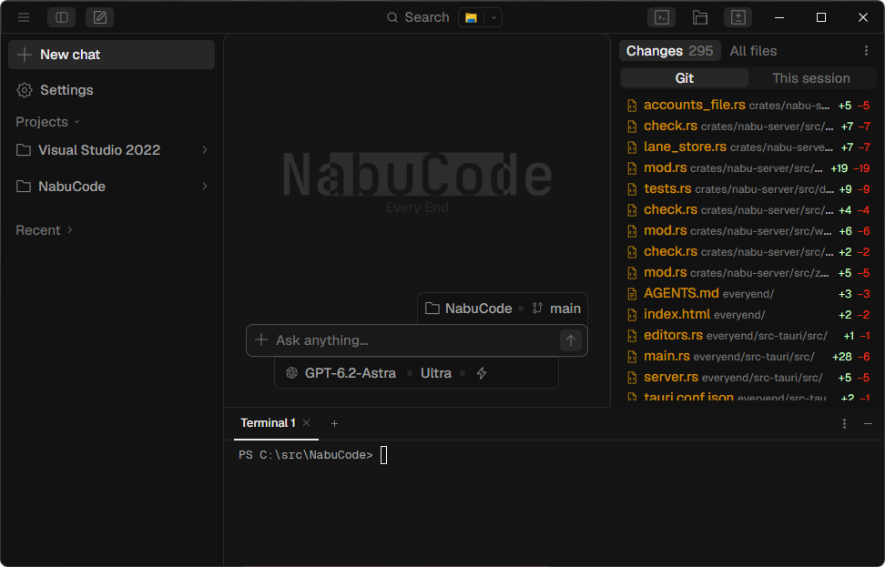

<p align="center">
  
</p>

<h1 align="center">NabuCode</h1>

<p align="center">A desktop coding agent.</p>

<p align="center">
  <a href="https://github.com/Koleso333/NabuCode/releases"></a>
  
  <a href="LICENSE"></a>
</p>

### The model stays itself

The harness doesn't tell the model how to work: no heavy rules, no extra layers. The model behaves as close to vanilla as possible.

### Light on context

The system prompt and tool descriptions are compact, so most of the context window stays free for your code and your task. Under 10K tokens with Opus 5.5 out of the box.

### Accounts and keys with routing

Sign in with accounts from services you already use, or add API keys. Routing is automatic: when one account or key hits its limit, NabuCode switches to another.

<p align="center">
  
</p>

## Download

Builds are on the [Releases](https://github.com/Koleso333/NabuCode/releases) page. Windows only for now.

- **stable** - tested versions
- **beta** - nearly done, minor bugs are possible
- **nightly** - fresh builds from development, may be rough

## Building

You need a stable Rust toolchain, Node.js 22 or newer, and the [Tauri 2 prerequisites](https://v2.tauri.app/start/prerequisites/) for Windows (Visual Studio C++ build tools, WebView2).

```powershell
git clone https://github.com/Koleso333/NabuCode.git
cd NabuCode\app
npm ci
powershell -ExecutionPolicy Bypass -File scripts\build.ps1
```

The result is a single `app\build\release\NabuCode.exe` with the server inside.

## What is inside

- `app` - the desktop app: Tauri 2 and SolidJS
- `crates/nabu-server` - the server `nabu` (`nabu serve`): sessions, tools, compaction, providers; the app starts it on its own
- `crates/nabu-protocol` - the messages between the server and the app, in Rust and TypeScript
- `providers` - subscription and account providers built on [NabuCore](https://github.com/Koleso333/NabuCore)

NabuCore is the model engine underneath; Cargo downloads it by itself on the first build. To work on it alongside, clone it next to this folder and point Cargo at it in `.cargo\config.toml`:

```toml
[patch."https://github.com/Koleso333/NabuCore"]
ncore = { path = "../NabuCore/crates/ncore" }
ncore-tokio = { path = "../NabuCore/crates/ncore-tokio" }
ncore-mcp = { path = "../NabuCore/crates/ncore-mcp" }
```

## License

[0BSD](LICENSE).

<br>
<br>

<p align="right">&nbsp;&nbsp;&nbsp;&nbsp;&nbsp;&nbsp;&nbsp;&nbsp;</p>
